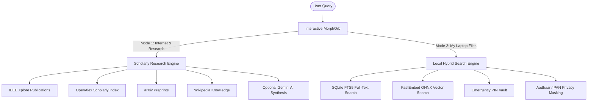

# Dyanphil (RecallAI)

<div align="center">


[](https://dyanphil.web.app)
[](https://github.com/vikash111-vickey/dyanphil-recallai-/archive/refs/heads/main.zip)
[](LICENSE)
[](https://www.python.org/)
[](https://react.dev/)

**An intelligent dual-mode research engine and privacy-first local search assistant.**  
Access peer-reviewed research papers from **IEEE Xplore**, **OpenAlex**, and **arXiv** 24/7 online, or search and organize personal files on your laptop with **100% on-device privacy**.

---

### 🌐 [Launch Web App (https://dyanphil.web.app)](https://dyanphil.web.app) • 💻 [Download Desktop Package (.ZIP)](https://github.com/vikash111-vickey/dyanphil-recallai-/archive/refs/heads/main.zip)

</div>

---

## 📌 Overview

**Dyanphil** bridges global academic literature and local personal storage through a unified fluid user interface powered by an interactive AI MorphOrb:

1. **Internet & Academic Research Mode (Cloud / Web 24/7)**:
   - Search millions of peer-reviewed conference publications and transactions from **[IEEE Xplore Digital Library](https://ieeexplore.ieee.org/)**.
   - Query global scholarly literature via **OpenAlex** (covering Nature, ACM, Springer, Elsevier, Oxford).
   - Retrieve **arXiv** scientific preprints across quantum computing, AI, physics, and computer science.
   - One-click direct PDF downloads and publisher links.
   - Optional client-side **Google Gemini AI** synthesis for deep conceptual literature reviews.

2. **Laptop & Desktop File Search Mode (Offline / 100% Private)**:
   - Search personal files, receipts, insurance policies, flight tickets, and identity documents on your computer.
   - **Zero Cloud Upload**: Your files never leave your laptop. Everything runs locally on CPU with SQLite FTS5 + ONNX vector embeddings.
   - **Automatic Masking**: Aadhaar, PAN, and payment cards are automatically masked to safeguard sensitive data.
   - **Emergency Vault**: PIN-encrypted vault (`hashlib.scrypt`) for rapid offline retrieval of passports and critical documents.

---

## 🚀 Quick Links & Access

| Channel | Link | Description |
|---|---|---|
| 🌐 **Live Web Application** | **[dyanphil.web.app](https://dyanphil.web.app)** | Instant access in your browser on laptop, mobile, or tablet. |
| ⬇️ **Download Desktop Code** | **[Download Repository .ZIP](https://github.com/vikash111-vickey/dyanphil-recallai-/archive/refs/heads/main.zip)** | Complete offline Windows package ready to run with `start.bat`. |
| 📂 **GitHub Repository** | **[github.com/vikash111-vickey/dyanphil-recallai-](https://github.com/vikash111-vickey/dyanphil-recallai-)** | Full open-source repository, issues, and contributions. |
| 📱 **Mobile App (PWA)** | Open `dyanphil.web.app` → **"Add to Home Screen"** | Install as a standalone native app on Android & iOS. |

---

## ✨ Key Features



### 1. Scholarly Research Features
- **Deep IEEE Xplore Integration**: Direct access to IEEE transactions, proceedings, and conferences with DOIs, author metadata, and venue details.
- **Open-Access Full Text & PDFs**: Instant download buttons on every scholarly result card.
- **Natural Language Parsing**: Automatically removes conversational query prefixes (`give me`, `show me`, `find`, `search for`) to extract core technical search topics.
- **Human-Like Responses**: Generates articulate, conversational summaries citing leading authors and paper titles.

### 2. Local Desktop & Privacy Features
- **Hybrid Local Search**: Combines BM25 keyword matching with CPU-accelerated vector search (sub-50ms latency).
- **8 GB RAM Windows Optimization**: Batch-limited processing and background file debouncing with `watchdog`.
- **Exclusion & Image Rules**: Automatically ignores system directories and OneDrive photo folders to keep search results clean.
- **Emergency Vault**: Access emergency documents (passports, medical reports) with quick-access PIN authentication.

---

## 💻 Desktop Installation & Setup

### Prerequisites
- **Operating System**: Windows 10 or 11
- **RAM**: 8 GB RAM or higher
- **Python**: Python 3.11+
- **Node.js**: Node.js 18+ *(only needed if modifying frontend source)*

---

### Step 1: Clone or Download
Clone using Git:
```powershell
git clone https://github.com/vikash111-vickey/dyanphil-recallai-.git
cd dyanphil-recallai-
```
*Or download and extract the [main.zip archive](https://github.com/vikash111-vickey/dyanphil-recallai-/archive/refs/heads/main.zip).*

---

### Step 2: One-Click Startup
From the project folder, run:

```cmd
.\start.bat
```

`start.bat` automatically:
1. Activates the Python virtual environment (`backend\.venv`).
2. Starts the backend server on `http://127.0.0.1:8000`.
3. Serves the production UI bundle.
4. Opens your browser to `http://127.0.0.1:8000`.

To stop the server at any time:
```cmd
.\stop.bat
```

---

## 🛠️ Command-Line Interface (CLI)

Manage indexing, pruning, and embeddings directly from PowerShell:

```powershell
# Index folders
.\backend\.venv\Scripts\python.exe -m app.cli index "D:\Documents"

# Prune excluded folders & clean the database
.\backend\.venv\Scripts\python.exe -m app.cli prune

# View indexed file counts per folder and extension
.\backend\.venv\Scripts\python.exe -m app.cli folders

# Run OCR on pending scanned documents
.\backend\.venv\Scripts\python.exe -m app.cli ocr --limit 20

# Run evaluation benchmarks
.\backend\.venv\Scripts\python.exe -m app.cli eval
```

---

## 🧪 Testing & Verification

Run the full pytest backend verification suite (161 tests):

```powershell
.\backend\.venv\Scripts\pytest.exe -q
```

Build production frontend:

```powershell
cd ui
npm run build
```

---

## 🔒 Security & Privacy Guarantees

- **No Remote Telemetry**: Zero personal document data or indexed text is transmitted to external servers.
- **Client-Side API Key Storage**: Optional Google Gemini API keys are saved exclusively in your browser's local storage (`localStorage`).
- **Encrypted Vault Storage**: Master vault keys are hashed via `scrypt` with in-memory session tokens.
- **Automatic Masking**: Government identifiers (Aadhaar, PAN, SSN) and payment cards are automatically redacted on ingestion.

---

## 📄 License

This project is licensed under the [MIT License](LICENSE) — free for personal, academic, and commercial use.

---

<div align="center">
  <b>Built with ❤️ by Dyanphil Team</b><br/>
  <sub>Empowering private personal knowledge & global scientific research.</sub>
</div>
